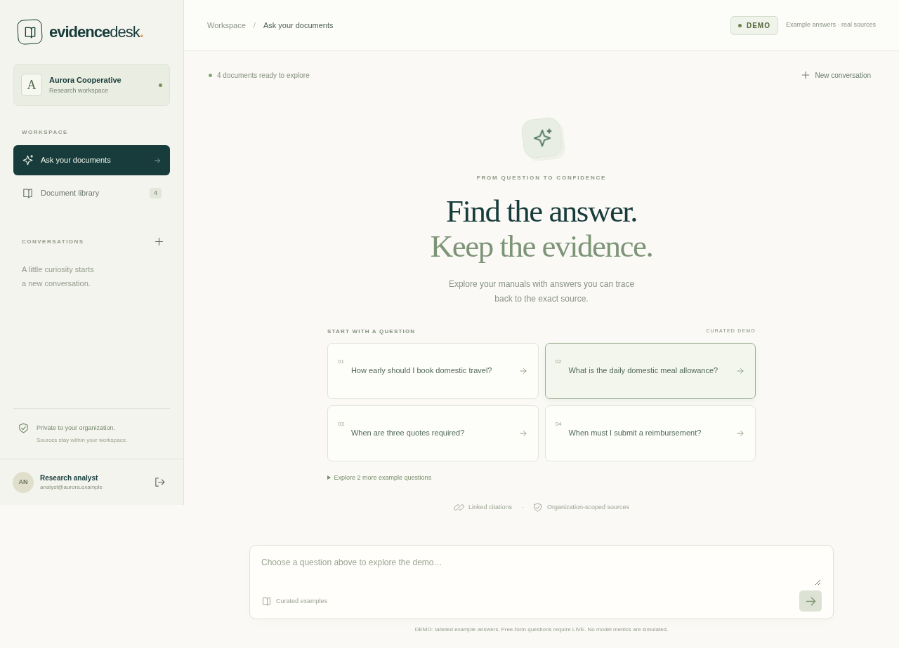

# Evidence Desk

A source-first document workspace for the fictional Aurora Cooperative and Meridian Studio. Upload text documents, process them durably, ask a curated sample question, and open the exact versioned evidence. Original synthetic material only; this is a portfolio product, not a bank system or a regulatory compliance claim.



## Run without credentials

Requirements: Docker Engine with Compose v2. No GPU or model downloads.

```sh
make demo
```

Open **http://localhost:3101**. Sign in with `analyst@aurora.example` / `demo-evidence`. The second organization is `analyst@meridian.example` with the same demonstration password. These intentionally public accounts are DEMO only and cannot authenticate in LIVE. The first launch builds images; wait for healthchecks and document processing. PDF extraction occurs only in the worker with Linux process resource limits; malformed or scanned PDFs become retryable processing errors.

DEMO runs PostgreSQL, sessions, permissions, file extraction, versioning, a durable worker, chat history and SSE. The model decision is replaced by six named, hash-bound fixtures. Free-form interpretation requires LIVE. The search API is explicitly lexical (the library UI filters titles/filenames); no embeddings or model timing/token/quality metrics are fabricated.

See [the technical audit and reproducible evidence](docs/audit.md) for corrected failure cases, contract boundaries and clean-install validation.

For this managed workspace's HTTPS proxy, use `docker compose -f compose.yaml -f compose.cloud.yaml up --build -d --wait`. The optional override uses the host CA bundle for builds and mounts it read-only for API/worker HTTPS at runtime. A normal development machine uses `make demo`.

## What to review

- **Backend:** `services/api/evidence/` contains SQLAlchemy models, migrations, authorization, extraction, hybrid retrieval, provider adapters and FastAPI endpoints.
- **Worker:** `services/worker/main.py` reuses the domain layer and claims leased PostgreSQL jobs with `FOR UPDATE SKIP LOCKED`.
- **Frontend:** `apps/web/` is Next.js/React/TypeScript with a same-origin streaming API gateway.
- **Contracts:** `/api/docs` and `/api/openapi.json` through the web entry point, plus the checked-in `docs/openapi.json` contract.
- **Evidence:** [verification](docs/verification.md), [architecture](docs/architecture.md), [LIVE activation](docs/live.md), [Spanish guide](docs/GUIA_ES.md), [trust/operations](docs/operations.md).

## Local development and checks

```sh
uv sync --frozen
cd apps/web && npm ci && cd ../..
# PostgreSQL with pgvector on localhost:5541 is required for integration tests.
# Use docker run --name evidence-dev-db -p 5541:5432 -e POSTGRES_USER=evidence \
#   -e POSTGRES_PASSWORD=evidence -e POSTGRES_DB=evidence -d pgvector/pgvector:0.8.0-pg17
PYTHONPATH=services/api uv run uvicorn evidence.main:app --port 8101
# Separate terminals:
PYTHONPATH=services/api uv run python services/worker/main.py
cd apps/web && npm run dev
```

`make check types test build` runs Python/frontend lint, type checking, tests and production frontend compilation. With the API and worker running: `cd apps/web && npm run test:e2e`. To use system Chromium set `PLAYWRIGHT_CHROMIUM_EXECUTABLE_PATH=/usr/bin/chromium`; otherwise install with `npx playwright install chromium`. CI is credential-free. Tests use only `TEST_DATABASE_URL` (default database `evidence_test`), require a name ending `_test`, and ignore the application `DATABASE_URL`. Create that isolated database before tests: `docker exec evidence-dev-db createdb -U evidence evidence_test`. Never place personal data in a test database.

## Implementation status

OpenAI and Gemini generation/structured streaming plus OpenAI embeddings use official SDKs. Both generation transports and OpenAI embeddings are tested through simulated HTTP transports. **No real provider call was made.** Live provider acceptance, model quality, production concurrency and Azure deployment remain unverified. [The LIVE guide](docs/live.md) gives explicit opt-in commands. Azure Bicep is compiled locally; no resources have been created or repositories published.

Forty-four synthetic evaluation prompts include expected evidence, abstention and cross-organization cases in `fixtures/evaluation.json`. These are evaluation inputs, not measured model performance. The deterministic domain assertions test access and evidence integrity, not immunity to prompt injection.

## Two-minute demo

1. **0:00–0:20:** Sign in to Aurora and point out the permanent DEMO label.
2. **0:20–0:50:** Select the meal allowance example, watch the response stream and open the source. Compare the answer with the 650 MXN sentence and version/section metadata.
3. **0:50–1:20:** Upload a small Markdown file; observe queued → processing → ready. Replace it as a new version and inspect history through the API.
4. **1:20–1:40:** Select the question without evidence to show abstention. Explain free-form LIVE activation and the missing-key status.
5. **1:40–2:00:** Sign in to Meridian; show its different library. Point reviewers to the direct-access/retrieval isolation tests and contract tests.
