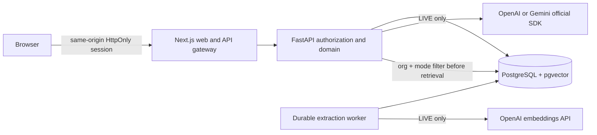

# Architecture and decisions

1. One API and one worker share the domain package. PostgreSQL is the job queue and state store; another message broker would add no necessary capability at portfolio scale. A five-minute processing lease recovers interrupted ingestion. Failed jobs expose a safe error and explicit retry; repeated processing keeps deterministic chunk identifiers.
2. Documents have immutable version rows; current-version retrieval excludes superseded content. Original uploaded bytes remain in bounded database storage, protected by the same organization/mode authorization as excerpts and downloads. This trades database size for atomic lifecycle cleanup at the 5 MiB document limit. Scanned PDF OCR is deliberately unsupported.
3. DEMO samples reference the SHA-256 of the original synthetic manual. A modified manual cannot silently support a canned answer. LIVE context comes from organization-filtered PostgreSQL full-text and vector candidates, fused with reciprocal rank. Index provider/model/dimensions must match configuration; mismatches block querying until reindexing.
4. A structured answer is validated before it is emitted to the browser. The provider stream is consumed as JSON; the UI streams the validated text, not incomplete JSON. Cancellation stops the provider task and records cancellation. A conversation lease recovers a stale busy flag after service interruption; provider requests themselves are not resumed.
5. Citations are constructed from retrieved rows, never from model-generated URLs. IDs must belong to the actual retrieved set. Source/organization locks coordinate deletion with answer commits. Deletion removes version/chunk/jobs by foreign-key cascade and clears affected historical citation links while retaining an explicit source-deleted flag.
6. DEMO and LIVE data are mode-namespaced across documents, users, sessions and conversations. A DEMO session/account is rejected in LIVE even when using the same database. Separate databases are additionally recommended for deployments.
7. OpenTelemetry instruments FastAPI and the RAG span; structured logs include request correlation IDs and actual server durations. No private model reasoning is requested or emitted. Telemetry exporters are an operator choice; no external collector is configured by default.

## Stable dependency selection

Selection checked 2026-11-05 against official Next.js install and React version pages, OpenAI API/SDK docs, Gemini structured output docs and pgvector README. Node 24.22.1, Next 16.4.5, React 19.3.1, Python 3.12.14, FastAPI 0.162.0, OpenAI SDK 3.45.0, google-genai 2.34.0 and OTel 1.44.0 are pinned. `uv.lock` and `apps/web/package-lock.json` lock transitive dependencies. FastAPI's website was unavailable from this environment; package metadata and the official GitHub source were used. Docker tags are versioned; a production promotion should pin reviewed image digests.

- https://nextjs.org/docs/app/getting-started/installation
- https://react.dev/versions
- https://github.com/fastapi/fastapi
- https://platform.openai.com/docs/guides/structured-outputs
- https://platform.openai.com/docs/guides/embeddings
- https://ai.google.dev/gemini-api/docs/structured-output
- https://github.com/pgvector/pgvector
